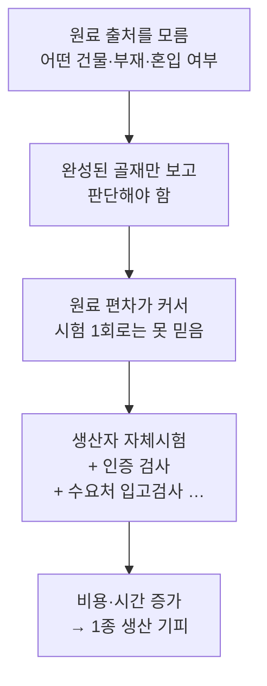
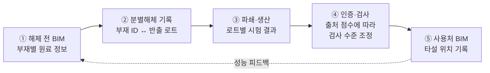

# 순환골재 BIM 이력관리 방안

← [[해체공사 MOC]] · 배경: [[순환골재]] · 관련: [[해체공사 BIM 적용 포인트]]

> [!abstract] 핵심 한 줄
> 검사를 BIM으로 **대체**하는 것이 아니라, 검사를 **믿을 근거**를 BIM으로 미리 만들어 주는 것이다.
> 해체 BIM부터 골재 로트까지 **출처 정보(Provenance)가 끊기지 않게** 이어서, 출처가 확실한 로트는 검사를 줄이는 방향.

## 0. 과제 목표

- 순환골재의 **저부가가치 활용**(성토·복토 위주) 문제를 해결하고 싶다
- **고품질 순환골재(1종) 사용량**을 늘리고 싶다
- 걸림돌: **인증 과정이 복잡하다** + 검사 신뢰성이 낮아 **2중·3중 검사**를 한다 → 간소화가 안 된다

> [!question] 확인 필요
> "1종"이 어떤 기준의 등급인지(순환골재 품질기준 고시, KS F 2573 등) 원문으로 확인하고 정의를 명확히 할 것. #확인필요

---

## 1. 문제 재정의: 왜 2중·3중 검사를 하나?



- 검사 자체가 부정확하다기보다, **검사 전 단계(해체·반출)의 정보가 끊겨 있어서** 검사 결과 하나에 모든 신뢰를 걸어야 하는 구조
- 각 주체가 **기록을 따로** 갖고 있어서 이미 한 시험도 다시 하게 됨
- 근본 원인은 [[순환골재#① 공급단의 품질 문제 — 분별해체 부재|분별해체 부재]]와 연결된다

---

## 2. 해결 방향: BIM 기반 출처 이력 체계



| 단계 | BIM이 하는 일 | 신뢰성에 주는 효과 |
|---|---|---|
| **① 해체 전** | 부재별 속성 입력: 원 콘크리트 설계강도, 코어 시험값, 건축 연도, 마감재 부착 여부, 석면·오염 여부 | 원료 품질을 **생산 전에** 예측 |
| **② 분별해체** | BIM 부재 ID ↔ 반출 트럭·로트 ID 연결 (QR 태그, 사진·드론 촬영, 올바로시스템 인계서 연계) | "구조체 콘크리트만 따로 나왔다"는 **혼입 방지 증빙** |
| **③ 생산** | 로트별 원료 출처 유지 + 밀도·흡수율·이물질·입도 시험값을 같은 로트 기록에 저장 | 원료 정보와 시험값을 **같이 볼 수 있음** |
| **④ 인증·검사** | 출처가 완전한 로트에 **출처 신뢰도 점수** 부여 → 검사 빈도 차등 | 신뢰 높은 로트 **검사 축소**, 출처 불분명 로트는 기존대로 |
| **⑤ 사용** | 신축 BIM에 어느 부재에 어떤 로트를 썼는지 기록 → 성능 모니터링 | **하자 책임 추적** 가능 → 설계자·레미콘사 기피 완화, 데이터 축적으로 점수 기준 정교화 |

---

## 3. 중복 검사를 줄이는 원리

### 3-1. 데이터 공유로 중복 제거
- 생산자·인증기관·레미콘사·감리자가 **하나의 로트 기록(Single Source of Truth)** 을 공유
- 이미 수행한 시험 결과를 다른 주체가 인정 → 같은 시험 반복 제거

### 3-2. 위험 기반 검사 (Risk-based Inspection)
- 모든 로트를 똑같이 의심하지 않고 **출처 정보가 확실한 로트만 검사 완화**
- 비유: 식품 **원산지 이력제**, 축산물 이력제

### 3-3. 데이터 자체의 신뢰 확보 (변조 방지)
- 기록 **수정 이력** 보존 (누가, 언제, 무엇을 바꿨는지)
- 사진 **촬영 시각·위치** 메타데이터
- **감리자 등 제3자 확인** 절차 포함
- → "검사도 못 믿는데 데이터는 믿을 수 있나?"라는 반론에 대한 대응

---

## 4. 출처 신뢰도 점수 (Provenance Score) 예시

| 항목 | 예시 기준 | 배점 |
|---|---|---|
| 원료 부재 정보 | BIM 부재 속성 완비 + 코어 강도 시험값 있음 | 30 |
| 분별해체 증빙 | 부재 ID–로트 연결 + 사진 기록 + 감리 확인 | 30 |
| 원료 구성 | 구조체 콘크리트 단일 원료 (마감재·조적 혼입 없음) | 20 |
| 과거 실적 | 같은 생산자의 이전 로트 시험 합격률 | 20 |

| 점수 | 검사 수준 (예시) |
|---|---|
| 80점 이상 | 검사 빈도 축소 (완화 검사) |
| 50~79점 | 기존 기준 검사 |
| 50점 미만 | 강화 검사 |

> [!warning] 배점·기준값은 가설
> 위 배점과 구간은 아이디어 단계의 예시다. 실제 시험 데이터로 **점수와 시험 합격률의 상관관계**를 검증해야 한다.

---

## 5. BIM 속성 설계 (IFC Property Set 예시)

### 해체 대상 건물 (원료 측)
```text
Pset_RecycledSource (예시, 직접 정의)
├─ SourceElementId        : BIM 부재 GUID
├─ ConcreteDesignStrength : 설계강도 (MPa)
├─ CoreTestStrength       : 코어 압축강도 시험값 (MPa)
├─ ConstructionYear       : 건축 연도
├─ FinishAttached         : 마감재 부착 여부 / 제거 여부
├─ Contamination          : 석면·염해·오염 여부
├─ SeparationVerified     : 분별해체 확인 여부 (감리 확인)
└─ OutputLotId            : 반출 로트 ID
```

### 순환골재 로트 (생산 측)
```text
Lot Record
├─ LotId
├─ SourceElementIds[]     : 원료가 된 부재 GUID 목록
├─ SourceBuilding         : 해체 건물 정보
├─ Density / Absorption   : 절대건조밀도, 흡수율
├─ ForeignMatter          : 이물질 함유량
├─ Grading                : 입도
├─ ProvenanceScore        : 출처 신뢰도 점수
└─ UsedIn[]               : 사용처 BIM 부재 GUID 목록 (사용 후 기록)
```

- 기존 [[해체공사 BIM 적용 포인트#해체용 BIM 모델에 필요한 속성 (예시 Property Set)|Pset_Demolition]]의 `Material`, `Volume / Weight`, `ReuseGrade`, `Condition`과 연결

---

## 6. 한계와 넘어야 할 것

> [!caution] 보고서에 꼭 넣을 부분
> 한계를 먼저 인정해야 아이디어의 신뢰도가 올라간다.

| 한계 | 내용 | 대응 방향 |
|---|---|---|
| **BIM ≠ 시험** | 흡수율·밀도는 부착 모르타르 양, 즉 **파쇄 공정**에 크게 좌우됨. 원료 정보만으로는 예측이 불완전 | 시험을 **없애는** 것이 아니라 **줄이는** 것 |
| **제도 근거** | 검사 빈도는 품질기준·인증 규정으로 정해져 있음 | "출처 증빙 로트 검사 완화 특례" 같은 **제도 개선 제안** 포함 |
| **입력 부담** | 현장에서 부재별 태깅·기록에 인건비 발생 (분별해체 기피 원인인 약 6% 비용 증가와 같은 문제) | **비용 효과 비교**: 검사비 절감 + 1종 판매가 상승 vs 기록 비용 |
| **데이터 위·변조** | 데이터를 조작하면 체계 전체가 무너짐 | 수정 이력, 메타데이터, 제3자 확인 |
| **참여 유인** | 생산자·레미콘사가 데이터를 공유할 이유가 필요 | 검사 완화라는 **직접 혜택**과 연결 |

---

## 7. 실증 시나리오 (과제 범위 제안)

1. **대상**: 2019년부터 분별해체가 의무인 **공공 철거공사** 1건 (가상 또는 실제 도면)
2. **해체 BIM 작성**: 부재별 원료 속성 입력 (`Pset_RecycledSource`)
3. **분별해체 시뮬레이션**: 해체 순서에 따라 부재 → 로트 매핑, 등급별 예상 물량 산출
4. **출처 점수 계산**: 로트별 점수 산출 → 검사 수준 결정
5. **비교 분석**: 기존 방식(전 로트 동일 검사) vs 제안 방식(점수별 차등 검사)의 **검사 횟수·비용·기간** 비교
6. **우리 시스템 연결**: nijja의 콘크리트·골재 재사용 평가 스코어링 기능에 출처 점수를 추가

---

## 8. 더 확인할 것 (To-do)

- [ ] 현재 순환골재 품질인증 절차: **누가, 어떤 시험을, 몇 번** 하는지 실제 흐름도 그리기 → 중복 지점 표시
- [ ] "1종" 등급 정의와 품질 기준값 확인 (순환골재 품질기준 고시, KS F 2573) #확인필요
- [ ] 품질인증 운영기관 자료 확인 (한국건설자원협회 등)
- [ ] 레미콘 공장 입고검사 항목·빈도 확인
- [ ] 유사 사례 조사: 해외 순환골재 이력관리, EU Digital Product Passport, Material Passport, 국내 건설자재 이력관리 사례
- [ ] 올바로시스템에서 로트 단위 연계가 가능한지 확인

## 연관 노트
- [[순환골재]]
- [[해체공사 BIM 적용 포인트]]
- [[해체공사 고려사항#6. 폐기물·자원순환]]
