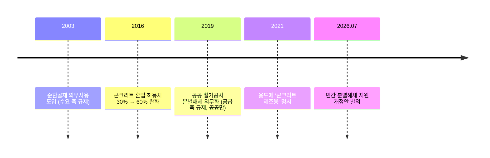

# 순환골재

← [[해체공사 MOC]] · 관련: [[해체공사 고려사항#6. 폐기물·자원순환]] · [[해체공사 BIM 적용 포인트]]

> [!quote] 한 줄 요약
> 순환골재는 **양(재활용률)은 채웠지만 질(콘크리트용)은 못 채운** 상태다.
> 핵심 원인은 **분별해체 없는 단순파쇄 → 낮은 품질 → 인증·신뢰 부족 → 저부가 용도 고착**이라는 악순환이다.

**순환골재**: 폐콘크리트 등 건설폐기물을 파쇄·선별해서 품질기준에 맞게 만든 골재 (「건설폐기물의 재활용촉진에 관한 법률」)

---

## 1. 장점

### 🌱 환경
- 채석·발파·운반 같은 **신규 채취 과정을 건너뛰므로** 탄소 배출이 적다
- 천연골재 채취로 인한 **산림 훼손과 자원 고갈**을 줄인다
  - 한국건설자원협회: 매년 **여의도의 100배가 넘는 면적**이 훼손된다고 지적
- 건설폐기물 **매립량 감소**

### 💰 경제성
- **단가가 매우 낮다**
  - 부산항 신항 서컨테이너터미널 사례: 천연골재 **㎥당 약 15,000원**, 순환골재 **약 3,100원**으로 **약 1/5 수준**, **약 25.6억 원 절감**
- 현장 인근에서 나온 골재를 쓰면 **운반비도 절감**

---

## 2. 단점 (재료·기술적 측면)

| 문제 | 내용 |
|---|---|
| **부착 모르타르** | 골재 표면에 기존 시멘트 페이스트가 붙어 있어 **흡수율이 높고 밀도가 낮음** |
| **품질 편차** | 원래 콘크리트의 강도·배합이 제각각이라 품질이 균일하지 않음 |
| **콘크리트 성능 저하** | 압축강도·탄성계수 감소, 건조수축·크리프 증가, 동결융해 등 내구성에 불리 |
| **불순물 혼입** | 단순파쇄로 만들면 목재, 플라스틱, 석고, 벽돌 등이 섞여 들어감 |
| **배합 관리 부담** | 흡수율이 높아 **프리웨팅**(사전 물 적시기)이나 단위수량 보정이 필요 |

---

## 3. 사용 현황

| 구분 | 내용 |
|---|---|
| **재활용률** | 건설폐기물 재활용률 공식 수치는 **98.3%**. 그러나 그중 **약 75%가 성토·복토용** |
| **주 용도** | 성토·복토, 도로 보조기층 같은 **저부가가치 용도** |
| **콘크리트용** | 약 **44만 톤, 0.88%** 에 불과 (2024 정부 보고서). 2010년대 후반 약 2%에서 **오히려 감소** |
| **품질인증** | 총 594건 중 **도로공사용 379건(64%)**, 콘크리트용 잔골재는 **25건** |

### 제도 변화 타임라인

---

## 4. 지금 순환골재를 쓰기 어려운 이유

### ① 공급단의 품질 문제 — 분별해체 부재
- 현장 대부분은 건물을 **한 번에 부순 뒤 잔해에서 골라내는 단순파쇄** 방식
- 분별해체는 인건비·공기가 늘어 기피됨 — 2012년 연구에서 **약 6% 비용 증가**로 추정
- **해체 단계에서 섞여 버리면 고품질 골재를 만들 수 없다** → 해체 공정이 출발점

### ② 가공·인증의 병목
- 콘크리트용 품질인증을 받을 수 있는 **설비·기술을 갖춘 업체가 소수**
- 인증업체 수(425개사 이상)는 늘었지만 **대부분 도로용**

### ③ 현장 신뢰도 부족
- 강도·내구성 편차 때문에 설계자·시공사가 **구조용 콘크리트에 쓰기를 꺼림**
- **하자 책임** 부담, 레미콘사도 **배합 관리가 번거로움**
- 정부도 **품질 신뢰도와 수급 불균형**을 과제로 인정

### ④ 제도 순서의 문제
- 2003년에 **수요 측 규제(의무사용)** 를 먼저 만들고, **공급 측 규제(분별해체)** 는 2019년에야 **공공부문에만** 도입
- 그 결과 **의무사용량을 성토·복토로 채우는 관행**이 굳어짐

### ⑤ 민간 지원책 미비
- 2026년 개정안은 **공사비 보조, 장비 융자, 세제 감면의 근거만** 만들고 구체적 규모는 시행령에 위임
- 따라서:
  - 실효성이 불확실하다
  - 해체 단계만 지원해서는 **인증 병목이 풀리지 않을 수 있다**
  - 혜택이 **대형 업체에 쏠릴** 우려가 있다

---

## 5. 과제(BIM·해체계획 시스템)와의 연결

> [!tip] 개정안의 빈 곳을 채우는 근거
> 이 악순환의 출발점은 **해체 단계**다. 해체 전에 "무엇이, 어디에, 얼마나" 있는지 알면 분별해체를 계획할 수 있다.

| 문제 | BIM·시스템으로 할 수 있는 것 |
|---|---|
| 분별해체 비용을 몰라서 기피함 | 부재별 재질·물량으로 **분별해체 추가 비용 정량화** (단순파쇄 대비 비교) |
| 섞여서 품질이 떨어짐 | 부재 단위 **자재별 회수 계획** — 콘크리트 / 조적 / 석고 / 목재를 해체 순서에 맞춰 분리 |
| 원래 콘크리트 품질 편차 | 부재 속성에 **원 콘크리트 강도·건축 연도·상태**를 기록 → 고품질 골재 원료 선별 |
| 수요처와 연결이 안 됨 | 예상 순환골재 **발생량·등급·시기**를 미리 산출해 인근 수요처와 연결 (운반비 절감) |
| 저부가 용도로만 처리 | 등급별(콘크리트용 / 도로용 / 성토용) 예상 물량 산출 → 경제성 비교 |

- 관련 속성 예시는 [[해체공사 BIM 적용 포인트#해체용 BIM 모델에 필요한 속성 (예시 Property Set)]]의 `Material`, `Volume / Weight`, `ReuseGrade`, `WasteType`, `Condition` 참고
- 우리 프로젝트의 **콘크리트·골재 재사용 가능성 평가** 기능과 바로 연결된다

> [!warning] 인용 시 주의
> 위 수치(98.3%, 0.88%, 44만 톤, 594건, 425개사, 6% 등)는 산군 블로그 글을 정리한 것이다. 보고서에 쓸 때는 원 출처(환경부 건설폐기물 통계, 2024 정부 보고서, 한국건설자원협회 자료, 국회 의안정보시스템)를 찾아 직접 인용하는 것이 좋다. #확인필요

## 출처
- [순환골재 재활용률 98%의 진실, 정부가 꺼낸 해법은 – 산군](https://www.sankun.com/blog/detail/1754_circular-aggregate-recycling-rate-selective-demolition-bill)
