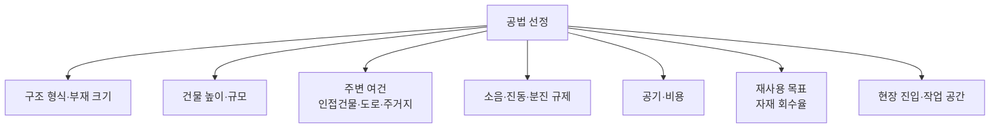

# 해체 공법과 장비

← [[해체공사 MOC]]

## 공법 한눈에 비교

| 공법 | 원리 | 장점 | 단점 | 주로 쓰는 곳 |
|---|---|---|---|---|
| **압쇄 공법** | 유압 집게(크러셔)로 콘크리트를 물어 부숨 | 소음·진동 적음, 국내 주력 | 분진 발생, 두꺼운 부재는 느림 | RC 건물 대부분 |
| **브레이커 공법** | 유압 해머로 반복 타격 | 단단한 부재·기초에 강함 | **소음·진동 매우 큼** | 기초, 지하 구조물, 보조 |
| **절단 공법** | 다이아몬드 와이어쏘·월쏘로 절단 | 저소음·저진동, 정밀, 블록 재사용 가능 | 비용 높음, 냉각수 필요 | 부분 해체, 리모델링, 원전·교량 |
| **코어드릴** | 구멍을 연속으로 뚫어 분리 | 정밀 | 느림 | 개구부 만들기, 절단 보조 |
| **발파 공법** | 기둥 등에 화약 장전 → 붕괴·전도 | 공기 매우 짧음 | 비산·진동·분진, 주민 반발, 인허가 까다로움 | 고층·대형 구조물, 굴뚝 |
| **정적 파쇄(팽창제)** | 구멍에 팽창제 넣어 균열 유도 | 무소음·무진동 | 느림, 온도 영향 | 진동 민감 지역, 암반·기초 |
| **유압 잭 / 스플리터** | 유압으로 쐐기 벌리기 | 저소음 | 소규모만 | 부분 파쇄 |
| **워터젯** | 초고압수로 콘크리트 파쇄 | 철근 손상 없음, 무진동 | 물 처리, 비용 | 보수·부분 해체 |
| **블록 해체 (Cut & Lift)** | 절단 후 크레인으로 들어 내림 | 현장 소음·분진 최소화, 부재 재사용 | 크레인 필요, 비용 | 도심 고층, 재사용 목적 |

## 해체 방향에 따른 특수 공법 (참고)

- **Top-down 일반 방식**: 위층부터 장비를 올려 해체. 국내 대부분.
- **폐쇄형 상부 해체 (일본 다이세이 TECOREP 등)**: 최상층에 덮개를 씌워 밀폐 공간 안에서 위층부터 해체 → 소음·분진 차단
- **잭다운(하부 해체) 방식 (일본 가지마 Cut & Take Down 등)**: 1층 기둥을 잭으로 받치고 잘라내면서 건물 전체를 한 층씩 내림 → 작업이 지상에서 이뤄져 안전
- 국내도 초고층 해체 수요 증가로 연구 중

## 주요 장비

| 장비 | 용도 | 비고 |
|---|---|---|
| **장붐 압쇄기** (Long-reach demolisher) | 지상에서 높은 층을 압쇄 | 붐 길이에 따라 작업 높이 결정. 전도 위험 → 지반 다짐, 작업반경 통제 |
| **굴삭기 + 압쇄기/브레이커** | 상층 탑재 또는 지상 작업 | 상층 탑재 시 **장비 중량 + 해체물 하중**을 슬래브가 견뎌야 함 |
| **소형 굴삭기 (미니)** | 상층 탑재, 내부 철거 | 크레인으로 인양 |
| **스키드 로더 / 원격 해체 로봇** | 좁은 실내, 위험 구간 | 무인 원격 조종 (Brokk 등) |
| **이동식 크레인 / 타워크레인** | 장비 인양, 블록 해체물 인양 | 인양 계획서 필요 |
| **와이어쏘 / 월쏘 / 코어드릴** | 절단 해체 | 냉각수 처리 |
| **집게(그래플) / 마그넷** | 폐기물 분류, 고철 선별 | |
| **덤프트럭** | 폐기물 반출 | 반출 경로·시간 계획 |
| **살수차 / 미스트 분사기(안개분무기)** | 분진 억제 | 해체 작업과 동시 가동 |

## 공법 선정 시 따지는 것

- 도심 + 인접 건물 근접 → 압쇄 + 절단, 저소음
- 기초·지하 → 브레이커 불가피한 경우 많음 (시간대 제한)
- 부재 재사용 목표가 크면 → **절단·블록 해체** (콘크리트 블록, 철골 부재)
- 높이가 장붐 도달 범위 초과 → 상층 탑재 방식

> [!tip] BIM 연결
> 장비의 **도달 범위(Reach)·작업 반경·위험 반경**을 BIM 모델 위에 시각화하면 장비 선정과 배치 검토가 쉬워진다. → [[해체공사 BIM 적용 포인트]]

## 연관 노트
- [[해체공사 절차와 순서]]
- [[해체공사 고려사항]]
