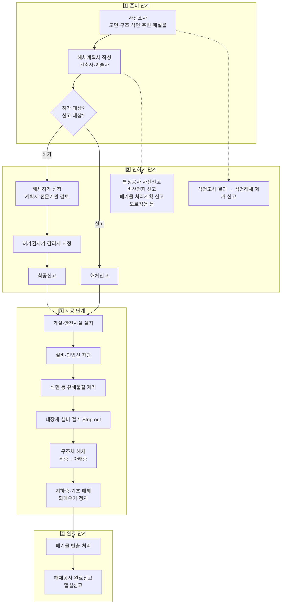

# 해체공사 절차와 순서

← [[해체공사 MOC]]

해체공사는 **행정 절차(서류)** 와 **현장 작업(시공)** 이 맞물려 진행된다. 둘을 나눠서 이해하면 쉽다.

---

## A. 전체 흐름

---

## B. 행정 절차 (서류의 흐름)

| 순서 | 절차 | 누가 | 핵심 내용 | 근거 |
|---|---|---|---|---|
| 1 | 사전조사 | 건축주 / 작성자 | 설계도서, 구조, 주변 현황, 지하 매설물 | 건축물관리법 |
| 2 | 석면조사 | 건축주 → 석면조사기관 | 일정 면적 이상 해체 시 **기관석면조사** | 산업안전보건법 제119조 |
| 3 | 해체계획서 작성 | 건축사·기술사 | 공법, 순서, 구조안전, 안전·환경 대책 → [[해체계획서]] | 건축물관리법 제30조 |
| 4 | 해체 허가 신청 / 신고 | 건축주 → 허가권자 | 규모에 따라 허가 또는 신고 | 건축물관리법 제30조 |
| 5 | 해체계획서 검토 | 허가권자 (전문기관 의뢰) | 허가 대상은 국토안전관리원 등 전문기관 검토 | 건축물관리법 (2022 개정) |
| 6 | 감리자 지정 | **허가권자** | 건축주가 아니라 허가권자가 지정 (유착 방지) | 건축물관리법 제31조 |
| 7 | 착공신고 | 건축주 | 허가 대상은 착공 전 신고 | 건축물관리법 (2022 개정) |
| 8 | 기타 신고 | 시공자 등 | 석면해체·제거 작업 신고, 특정공사 사전신고(소음·진동), 비산먼지 신고, 건설폐기물 처리계획 신고, 도로점용 허가 | 각 개별법 |
| 9 | 감리 | 감리자 | 해체계획서 이행 확인, 감리일지, 위반 시 시정·중지 요청 | 건축물관리법 제32조 |
| 10 | 해체공사 완료신고 | 건축주 | **폐기물 반출 완료일부터 30일 이내** | 건축물관리법 제33조 |
| 11 | 멸실신고 / 건축물대장 정리 | 건축주 | 건축물대장 말소 | 건축물관리법 제34조 |

> [!note] 허가 vs 신고 구분
> 자세한 기준은 [[해체공사 관련 법령#건축물관리법]] 참고.
> 대략 **연면적 500㎡ 미만 + 높이 12m 미만 + 지상·지하 합쳐 3개 층 이하** 를 모두 만족하면 신고, 아니면 허가.

---

## C. 현장 작업 순서 (시공의 흐름)

### 1. 사전조사
- **설계도서 확보**: 구조도면이 없으면 현장 실측, 철근 탐사, 코어 채취
- **구조 상태**: 균열, 철근 부식, 증·개축 이력, 구조 형식(RC, SRC, 철골, 조적)
- **유해물질**: 석면(슬레이트 지붕, 텍스 천장재, 보온재, 내화피복), PCB(구형 변압기), 형광등(수은), 냉매(에어컨·냉동기)
- **주변 환경**: 인접 건물 거리·상태, 도로 폭, 보행자 동선, **버스정류장·횡단보도**, 학교·병원
- **지하**: 지하층 유무, 상수도·가스·전기·통신 매설물, 인접 지반

### 2. 가설·안전시설 설치
- 가설울타리(가설 펜스), **방음벽·방진막**, 출입구 통제, 신호수 배치
- 외부 비계 + 낙하물 방지망, 비산 방지 그물
- **살수 설비** (분진 억제용 스프링클러, 살수차)
- 세륜 시설 (차량 바퀴 세척)
- 필요시 인접 건물·도로 쪽 보호 구조물, **보행자 통로 우회**, 도로 점용

### 3. 설비·인입선 차단 (라이프라인 철거)
- 전기, 가스, 상하수도, 통신선을 각 기관에 신청해 **차단·철거**
- 가스 잔류 여부 확인 (폭발 위험)
- 현장용 임시 전기·용수는 별도로 확보 (살수용 물이 필요함)

### 4. 석면 등 유해물질 제거
- **반드시 본 해체 전에** 석면해체·제거업자가 제거
- 작업장 밀폐(음압 유지), 습식 작업, 개인보호구, 석면 비산 농도 측정
- 제거 후 **잔재물 확인(청소 상태 확인)** 을 거쳐야 본 해체 가능
- PCB 함유 기기, 형광등, 냉매 등도 분리 회수

### 5. 내장재·설비 철거 (Strip-out, 내부 철거)
- 창호, 문, 석고보드, 천장재, 바닥재, 목재, 배관·덕트, 전선, 위생기구
- **재질별 분리배출** → 재활용률이 여기서 결정됨
- 구조체만 남기는 "골조 상태(Skeleton)"로 만든다

### 6. 구조체 해체 (본 해체)
일반적인 원칙: **위층 → 아래층**, 한 층 안에서는 **슬래브 → 보 → 벽 → 기둥**

층별 세부 순서 예 (RC조 기준):
1. 옥상 구조물(옥탑, 물탱크, 난간) 제거
2. **슬래브** 해체 (가장자리 → 중앙 또는 지정된 방향)
3. **작은 보 → 큰 보**
4. 비내력벽 → **내력벽**
5. **기둥** (마지막. 전도 방향을 건물 안쪽으로 유도)
6. 해체물을 하부로 내리거나 반출 (**과도하게 쌓지 않음**)

장비 운용 방식:
- **지상 장붐 장비**: 장붐 압쇄기가 바깥에서 위층부터 물어뜯듯 해체. 중층 건물에 많이 씀
- **상층 탑재 방식**: 소형 굴삭기(압쇄기 부착)를 크레인으로 옥상에 올려 위층부터 해체
  - 장비 + 해체물 하중이 슬래브에 걸리므로 **하부 층에 동바리(잭 서포트) 보강** 필수
  - 몇 개 층을 보강할지는 **구조검토**로 결정 (통상 2~3개 층 이상)
- 발파 해체: 고층·대형 구조물을 한 번에 무너뜨림 (국내는 드묾)

### 7. 지하층·기초 해체
- 지하 외벽은 흙막이 역할을 하므로 **인접 지반·건물 영향**을 고려해 순서 결정
- 필요하면 흙막이 가시설 설치 후 해체
- 되메우기, 다짐, 정지 (신축이 이어지면 범위 협의)

### 8. 폐기물 반출·처리
- 콘크리트 덩어리 → 파쇄 → **순환골재**
- 철근·철골 → 고철로 매각 (해체 비용을 일부 상쇄)
- 혼합폐기물 최소화가 비용 절감의 핵심
- 올바로시스템(폐기물 전자인계)으로 인계·인수 기록

### 9. 완료
- 해체공사 완료신고 → 멸실신고 → 건축물대장 말소

---

## D. 구조 형식별 차이 (간단히)

| 구조 | 해체 특징 |
|---|---|
| RC조 (철근콘크리트) | 국내 주류. 압쇄로 콘크리트를 부수고 철근은 절단·분리 |
| SRC조 | 철골이 들어 있어 압쇄만으로 어렵고 **가스 절단**이 필요 |
| 철골조 | 볼트·용접부 절단 후 크레인으로 **역순 조립 해체**. 부재 재사용 가능성 높음 |
| 조적조 | 벽이 구조체. 벽을 함부로 먼저 헐면 붕괴 위험 |
| 목조 | 수작업 + 소형 장비. 목재 분리 재활용 |
| PC조 | 접합부 절단 후 부재 단위로 들어냄 |

## 연관 노트
- [[해체 공법과 장비]]
- [[해체공사 고려사항]]
- [[해체계획서]]
